<div align="center">

# Canvas de Citas

**Tu tesis en un tablero:** las fuentes, sus citas y tus ideas en un lienzo visual, con lector de PDF,
biblioteca, app para el celular y conexión con Claude Code. Sin nube ni cuentas.

[**Descargar**](https://github.com/1xmanMAX/canvas-de-citas/releases/latest) ·
[Un día de trabajo](#un-día-normal-de-trabajo) ·
[Funciones](#todo-lo-que-puedes-hacer) ·
[Atajos](#atajos-de-teclado) ·
[Dónde están tus datos](#dónde-viven-tus-datos) ·
[Para desarrollar](#para-desarrollar)

   

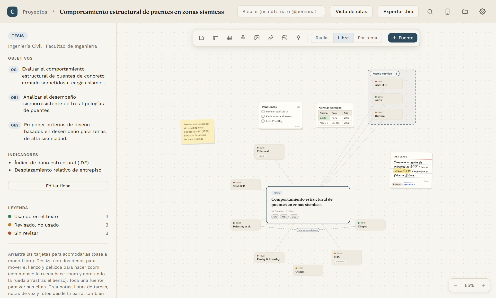

</div>

---

## En 30 segundos

- **Un proyecto = un lienzo.** El tema de tu tesis va al centro y cada fuente (paper, norma, libro) es una tarjeta
  alrededor. Encima pones notas, listas de pendientes, tablas, fotos, notas de voz y flechas que las relacionan.
- **Lees y citas sin salir de la app.** Abres el PDF, seleccionas una frase y se vuelve una nota con su página.
  Cada nota recuerda de dónde salió: un clic y vuelves al lugar exacto del documento.
- **Cada paper tiene su propio tablero de lectura.** Ahí se juntan las citas de ese paper; con la **chincheta**
  llevas al lienzo general solo las que importan.
- **Todo queda en una carpeta tuya** (archivos JSON que también entiende Claude Code) y se sincroniza con el
  celular **por el Wi-Fi de casa**, sin internet.

## Cómo se organiza

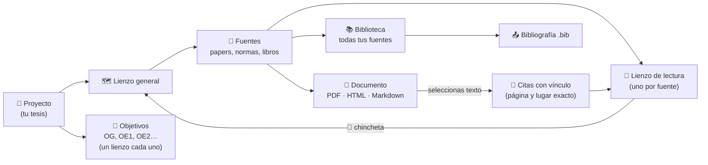

| Pieza | Qué es | Dónde la ves |
|---|---|---|
| **Proyecto** | Una tesis o trabajo, con objetivos e indicadores | Pantalla de inicio |
| **Fuente** | Un paper, norma o libro con su referencia y estado (usada · revisada · sin revisar) | Tarjeta en el lienzo, ficha y Biblioteca |
| **Cita** | Texto textual o paráfrasis de una fuente, con página y dónde la usas | Ficha de la fuente, notas del lienzo |
| **Lienzo general** | El tablero del proyecto | Al abrir un proyecto |
| **Lienzo de lectura** | El tablero propio de cada fuente, junto a su documento | Al abrir el documento de una fuente |
| **Tarjetas** | Notas, listas, tablas, fotos, notas de voz, agrupadores y conexiones | En cualquier lienzo |

---

## Un día normal de trabajo

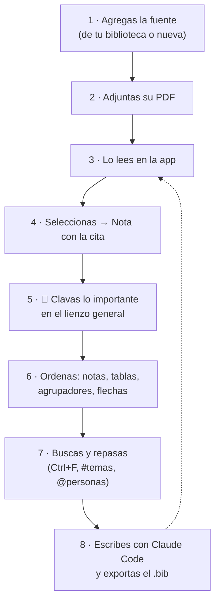

### 1. Abre tu proyecto

Cada proyecto muestra cuántas fuentes ya usas en el texto (🟢), revisaste pero no usas (🟠) o aún no revisas (🔴).
**Nuevo proyecto** crea su carpeta; **Abrir proyecto** carga una que ya tengas.

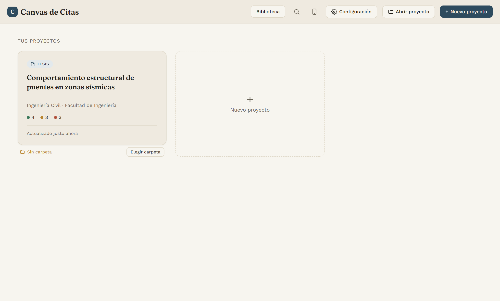

### 2. Agrega la fuente y su documento

Con **+ Fuente** eliges una de tu biblioteca o creas una nueva (autores, año, título, DOI…); Claude Code puede
verificarla en CrossRef, OpenAlex y otras bases. En la ficha de la fuente ves su
referencia, sus citas y dónde las usas; **arrastra el PDF** sobre la ficha para adjuntarlo (los papers con
documento llevan un clip azul en el lienzo).

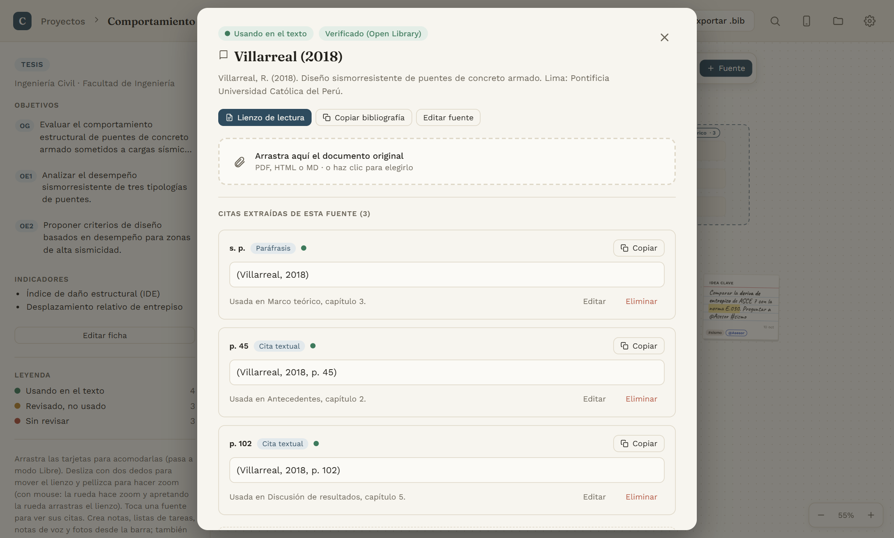

### 3. Lee y cita: el flujo central

Toca **Abrir** en la ficha: el documento se abre a la derecha y su **lienzo de lectura** a la izquierda.
Selecciona una frase → **Nota con la cita**. La nota sale con autor, año y página, unida a la fuente con un hilo, y
con **↗ Vínculo** vuelves a ese lugar del PDF cuando quieras.

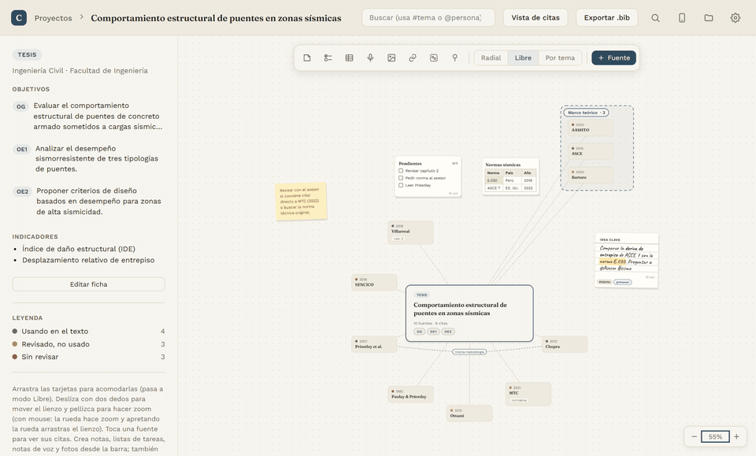

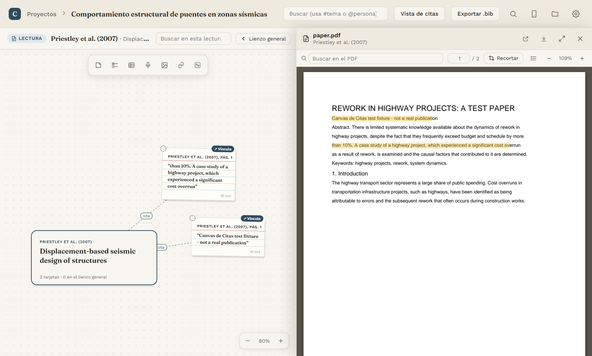

En el visor también puedes **buscar** dentro del PDF (Ctrl+F), **recortar** una tabla o figura (se vuelve una foto
en el lienzo), hacer zoom y abrir el documento **en otra ventana**.

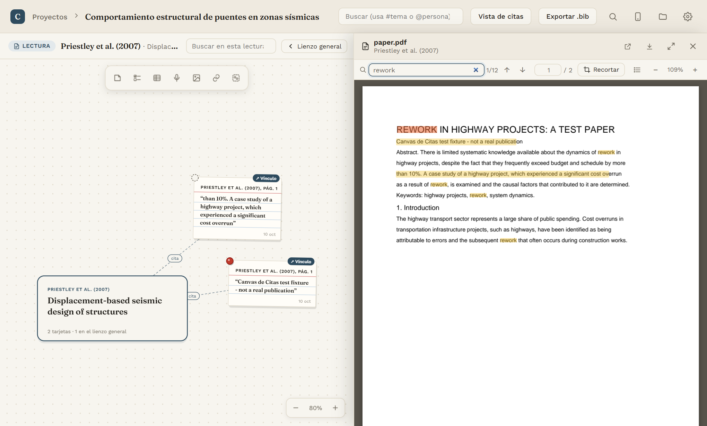

### 4. Clava lo importante en el lienzo general

La **chincheta** de cada tarjeta la pone también en el lienzo general (es la misma tarjeta, en otro lugar). Ahí
muestra de qué fuente viene, y cada fuente lleva un contador de su lectura. Para volver de la lectura usa
**‹ Lienzo general** o Esc.

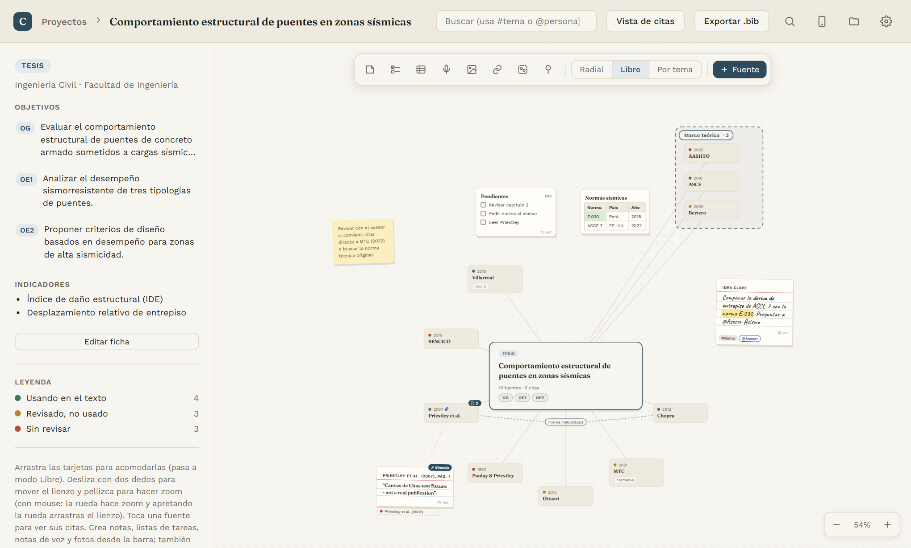

### 5. Organiza tus ideas

<table>
<tr>
<td width="50%">

**Notas con formato y letra.** Negrita, cursiva, subrayado y resaltado (Ctrl+B, Ctrl+I, Ctrl+U, Ctrl+Shift+H),
13 letras para elegir, tres papeles (adhesiva, ficha rayada, tarjeta) y seis colores. Escribe `#tema` o
`@Persona` para etiquetar.

</td>
<td width="50%">

**Tablas** creadas desde la barra o **pegadas desde Excel, Word o Sheets** (Ctrl+V). Combina y pinta celdas,
agrega filas y columnas con los “+” de los bordes.

</td>
</tr>
<tr>
<td>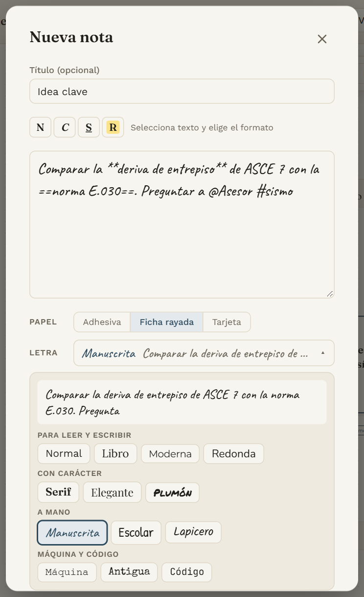</td>
<td>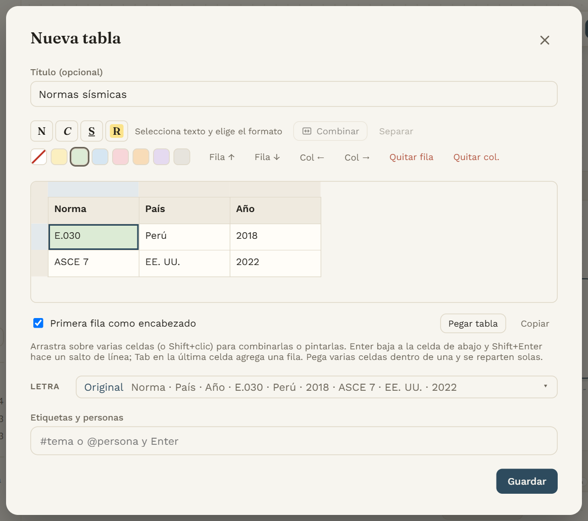</td>
</tr>
</table>

Además: **listas de tareas**, **notas de voz** con transcripción, **fotos** con anotaciones y dibujo, **flechas**
con etiqueta entre dos elementos, **agrupadores** (recuadros punteados que se ajustan solos a lo que contienen y
se mueven juntos) y el modo **tablero de corcho** con chinchetas e hilos rojos. Cada **objetivo** (OG, OE1…)
tiene su propio lienzo.

### 6. Encuentra cualquier cosa

**Ctrl+F** busca en todo: notas, citas, fuentes, tablas, transcripciones. Combina palabras, `#temas` y `@personas`.

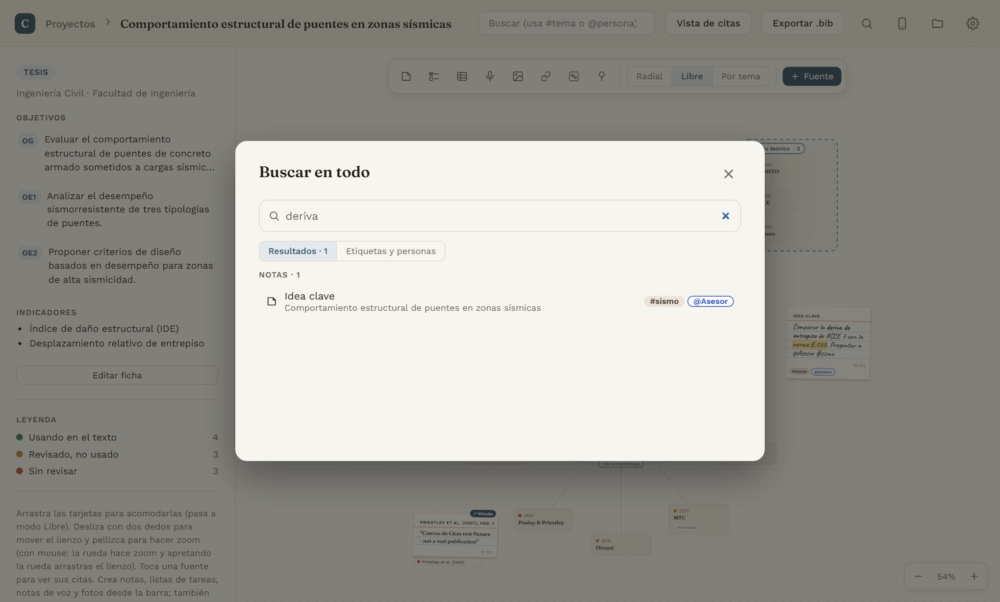

### 7. Repasa tu biblioteca y exporta

La **Biblioteca** reúne todas tus fuentes de todos los proyectos, con filtros por tipo y verificación, ordenadas por
autor, año o tema. **Exportar .bib** te da la bibliografía para Word, LaTeX o Zotero.

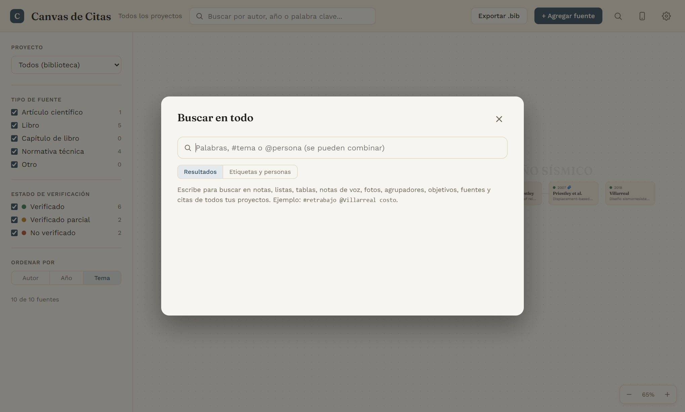

### 8. Sigue en el celular

La app Android es la misma app. Tu PC guarda la versión común y cada aparato se pone al día **por el Wi-Fi de casa**
(al abrir, cada 5 minutos y poco después de cada cambio). Solo viaja lo que cambió, todo va cifrado y, si editaste
en dos aparatos a la vez, se junta.

<p>
  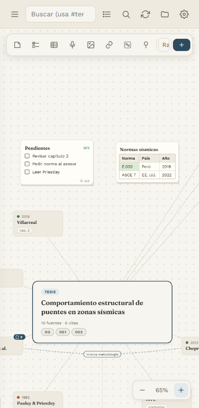
  &nbsp;
  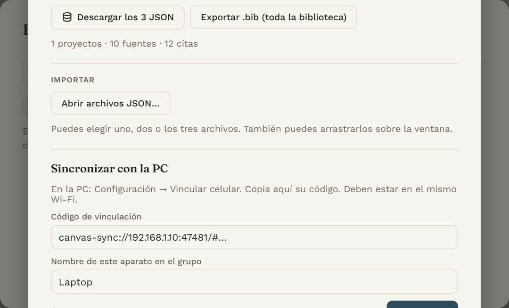
</p>

---

## Todo lo que puedes hacer

| Área | Funciones |
|---|---|
| **Lienzo** | Desplazar y hacer zoom fluido aun con cientos de tarjetas · modos Radial, Libre y Por tema · tablero de corcho · encuadrar todo · pegar (Ctrl+V) o arrastrar texto, imágenes, audios y tablas |
| **Tarjetas** | Notas (3 papeles, 6 colores, 13 letras, formato) · listas de tareas · tablas · notas de voz con transcripción · fotos con anotaciones y dibujo · conexiones con etiqueta · agrupadores |
| **Fuentes y citas** | Ficha con referencia, citas textuales o paráfrasis con página y estado de uso · copiar la cita o la bibliografía con un clic · referencias del paper (su bibliografía) |
| **Documentos** | Visor de PDF propio (PDFium, rápido con PDFs grandes) · HTML y Markdown · búsqueda · recortes · citas con vínculo · otra ventana · arrastrar el archivo a otras apps |
| **Lectura** | Un lienzo por fuente al lado del documento · chincheta al lienzo general · contador de lectura en cada fuente |
| **Organizar** | `#temas` y `@personas` en cualquier texto · buscador general (Ctrl+F) · un lienzo por objetivo |
| **Biblioteca** | Todas las fuentes de todos los proyectos · filtros · exportar `.bib` y los JSON |
| **Aparatos** | App de Windows · app Android · sincronización por Wi-Fi local, cifrada y sin nube · pasar archivos del celular a la PC |
| **Claude Code** | Lee y edita tus proyectos, verifica citas y agrega fuentes, notas o conexiones |

### PC y celular: las mismas funciones

Lo único que cambia es **cómo** se hacen algunas cosas:

| | En la PC (Windows) | En el celular (Android) |
|---|---|---|
| Dónde se guardan los datos | Una carpeta por proyecto | En el celular, sincronizados con la PC |
| Guardar un archivo (JSON, `.bib`, PDF) | Se descarga | Hoja **Compartir**: Drive, Archivos, WhatsApp… |
| Traer archivos | Arrastrar, pegar o recibirlos del celular | **Compartir → Canvas de Citas** desde cualquier app |
| Transcribir notas de voz | En vivo mientras hablas (necesita internet) | Al terminar de grabar, sin internet |
| Vincular con la PC | Muestra el código y el QR | Escanear el QR o pegar el código |

## Atajos de teclado

| Atajo | Qué hace |
|---|---|
| **Ctrl+F** | Buscar en todo (con un PDF abierto, busca dentro del PDF) |
| **Ctrl+O** | Abrir un documento en el visor (también puedes soltarlo sobre la app) |
| **Ctrl+V** | Pegar en el lienzo: texto → nota, imagen → foto, tabla de Excel/Word → tabla |
| **Ctrl+B · Ctrl+I · Ctrl+U · Ctrl+Shift+H** | Negrita, cursiva, subrayado y resaltado en el texto seleccionado |
| **Esc** | Cerrar el visor, el recorte o el lienzo de lectura (vuelve al general) |
| **Rueda del mouse** | Zoom hacia el cursor (Shift + rueda desplaza; se cambia en Configuración) |
| **Botón central + arrastrar** | Mover el lienzo |
| **Dos dedos / pellizco** | Desplazar y hacer zoom en trackpad o pantalla táctil |
| **Enter · Tab** | En una tabla: bajar a la celda de abajo · pasar a la siguiente |

---

## Dónde viven tus datos

Nada se sube a internet. Cada proyecto vive en **su carpeta**, en archivos que puedes abrir, respaldar o
versionar; los documentos quedan dentro de esa carpeta (`fuentes/<id>/documento.pdf`).

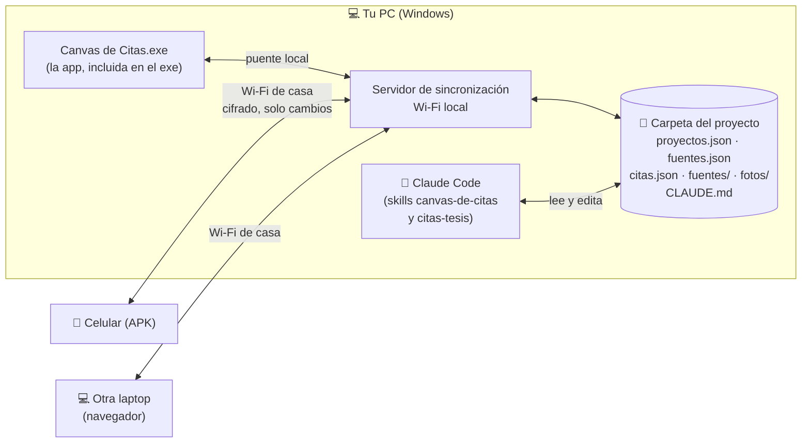

| Archivo | Qué guarda |
|---|---|
| `proyectos.json` | Proyectos, objetivos y todo lo de sus lienzos (notas, listas, tablas, fotos, conexiones, lecturas…) |
| `fuentes.json` | Las fuentes con su referencia, tema y etiquetas |
| `citas.json` | Las citas de cada fuente en cada proyecto |
| `fuentes/<id>/documento.*` | El PDF, HTML o Markdown de cada fuente |
| `fotos/<id>.*` | Las fotos en su resolución original |
| `CLAUDE.md` | Resumen de todo para que Claude Code entienda tu proyecto |

### Cómo se sincroniza

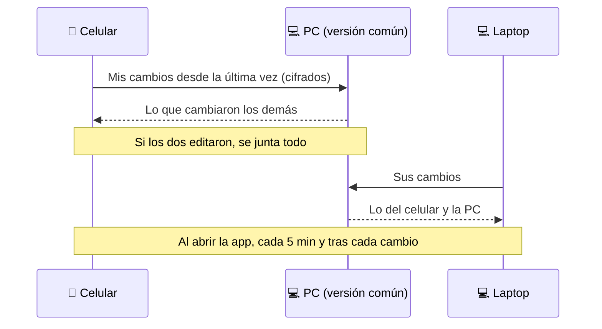

---

## Instalar

En **[Releases](https://github.com/1xmanMAX/canvas-de-citas/releases/latest)** está la última versión:

| Archivo | Para qué |
|---|---|
| `CanvasDeCitas-Windows-vX.Y.Z.zip` | **PC con Windows.** Descomprime y ejecuta `Instalar.cmd`: crea los accesos directos y deja lista la sincronización. Trae la app dentro: funciona sin internet |
| `CanvasDeCitas-Android-vX.Y.Z.apk` | **Celular Android.** Se instala encima de la versión anterior sin perder nada |
| `CanvasDeCitas-web-vX.Y.Z.zip` | La app web, para servirla donde quieras |

**Primeros pasos**

1. Abre la app y toca **Cargar ejemplo** para probar con un proyecto de muestra.
2. **Nuevo proyecto** crea tu proyecto con su carpeta (o **Abrir proyecto** si ya tienes una).
3. **Celular:** instala el APK y, en *Sincronizar con la PC*, escanea el QR que muestra la PC
   (Configuración → Vincular celular). Deben estar en el mismo Wi-Fi.
4. **Otra laptop:** abre la app web, pega el mismo código de vinculación y ponle un nombre.

## Con Claude Code

La carpeta del proyecto es la misma con la que trabajan las skills:

- **citas-tesis**: revisa y verifica citas según tu manual y en bases académicas (CrossRef, Semantic Scholar,
  OpenAlex…), y guarda la metadata exacta.
- **canvas-de-citas** ([claude-skill/](claude-skill/canvas-de-citas/)): Claude lee y edita tu lienzo: agrega fuentes,
  citas, notas, tablas, tareas o conexiones y busca en tus notas y audios.

Ejemplos de lo que puedes pedirle:

> *"Agrega a mi tesis el paper con DOI 10.1016/… y verifica la referencia."*<br>
> *"¿Qué citas de Priestley tengo sobre deriva de entrepiso? Hazme un párrafo para el marco teórico."*<br>
> *"Crea en el lienzo una tabla que compare E.030 y ASCE 7."*

Los cambios de Claude aparecen solos en la app (revisa la carpeta cada pocos segundos).

---

## Preguntas frecuentes

<details>
<summary><b>¿Necesito internet?</b></summary>

No. La app de Windows y la de Android traen todo dentro, y la sincronización usa el Wi-Fi de casa (sin salir a
internet). Solo la transcripción en vivo de notas de voz en la PC necesita conexión.
</details>

<details>
<summary><b>¿Dónde están mis PDFs?</b></summary>

Dentro de la carpeta de cada proyecto, en `fuentes/<id>/documento.pdf`. Desde la ficha o el visor puedes
descargarlos o arrastrarlos a otra app.
</details>

<details>
<summary><b>¿Cómo vuelvo del lienzo de lectura al general?</b></summary>

Con el botón **‹ Lienzo general** en la barra del lienzo de lectura, o con **Esc**.
</details>

<details>
<summary><b>¿Puedo usarlo con Word, LaTeX o Zotero?</b></summary>

Sí: **Exportar .bib** genera la bibliografía en BibTeX, que importan Zotero, Mendeley, LaTeX y los complementos de Word.
</details>

<details>
<summary><b>Edité en el celular y en la PC a la vez, ¿pierdo algo?</b></summary>

No. Al sincronizar se juntan los cambios de los dos aparatos.
</details>

---

## Ideas y mejoras

¿Algo no funciona o se te ocurre cómo hacerla mejor? Abre un
[issue](https://github.com/1xmanMAX/canvas-de-citas/issues) con:

1. **Qué hacías** (por ejemplo: "abrí el PDF desde la ficha"),
2. **Qué esperabas** y **qué pasó**,
3. una **captura** si se puede, y si fue en Windows, Android o el navegador.

---

## Para desarrollar

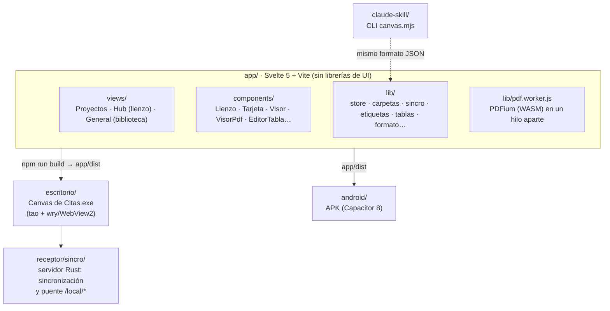

| Carpeta | Qué hay |
|---|---|
| [`app/`](app/) | La app (Svelte 5 + Vite) y sus pruebas (`tests/unit`, `tests/e2e`) |
| [`escritorio/`](escritorio/) | App de Windows: ventana WebView2 con la app incluida (`build.rs` mete `app/dist` en el exe) |
| [`android/`](android/) | App Android (Capacitor 8) que empaqueta `app/dist` |
| [`receptor/sincro/`](receptor/sincro/) | Servidor de sincronización (Rust) que corre en la PC |
| [`claude-skill/`](claude-skill/) | Skill de Claude Code |
| [`docs/`](docs/) | Diseños, planes, notas de versión y capturas |

```bash
cd app
npm ci
npm run dev                         # desarrollo en http://localhost:5173
npm test                            # pruebas unitarias
npm run build                       # app/dist
npm run test:e2e                    # pruebas en el navegador (necesita Chrome)
node tests/e2e/rendimiento.mjs      # fluidez del lienzo con un tablero grande
npm run test:integracion            # app ↔ servidor de sincronización (necesita Rust)
node scripts/capturas-readme.mjs    # regenera las capturas y el GIF de este README (ffmpeg para el GIF)

cd ../escritorio && cargo build --release   # exe de Windows (después de npm run build)
cd ../android && npm ci && npm run apk      # APK (JDK 21 + Android SDK)
cd ../receptor/sincro && cargo test         # servidor de sincronización
```

**Reglas del proyecto:** ligera y fluida en una PC modesta y en el celular; lo costoso en hilos aparte o cargado
bajo demanda; cada función nueva con sus pruebas; el formato de los JSON es un contrato (los campos nuevos,
opcionales). La guía completa está en [CLAUDE.md](CLAUDE.md).

Todas las capturas usan el **proyecto de ejemplo** de la app, no datos reales.
